Assignment 4: Forms and Validation

Name: Zhanserik Zharylgassyn
Group: IT-2501

This project uses HTML, CSS, and Bootstrap 5.3.8. There is no JavaScript in the website and no build step.

How to run

Open index.html in a modern browser. Bootstrap is saved in assets, so the page also works offline. For a local server, run python -m http.server 8000 and open http://localhost:8000.

Part 1. Basic HTML Forms

Task 0. Simple Contact Form

A contact form with Name, Email, Message, and a Submit button. Every field has its own label.

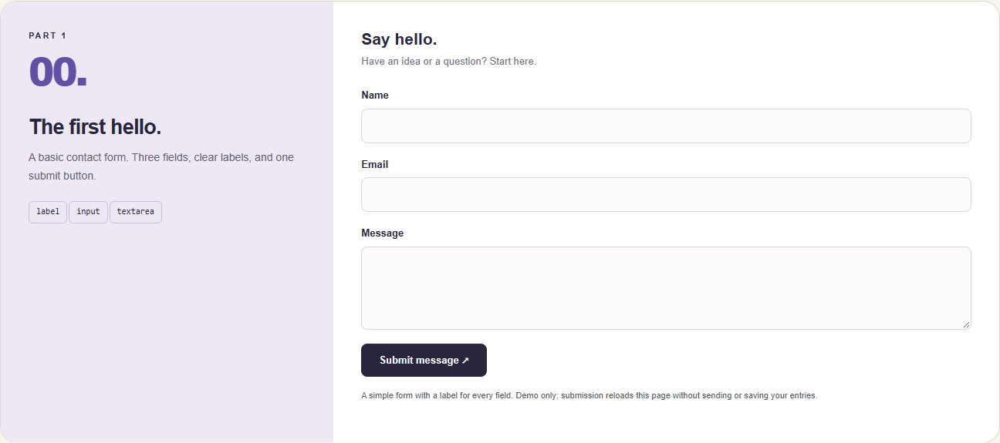

Task 1. Form with HTML5 Validation

The form uses required, email type, minlength, and maxlength. The name needs at least 2 characters and the message needs 10 to 500 characters. The browser stops submission when required fields are empty or the email is invalid.

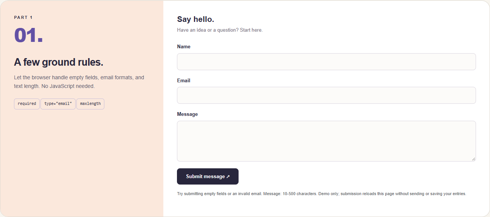

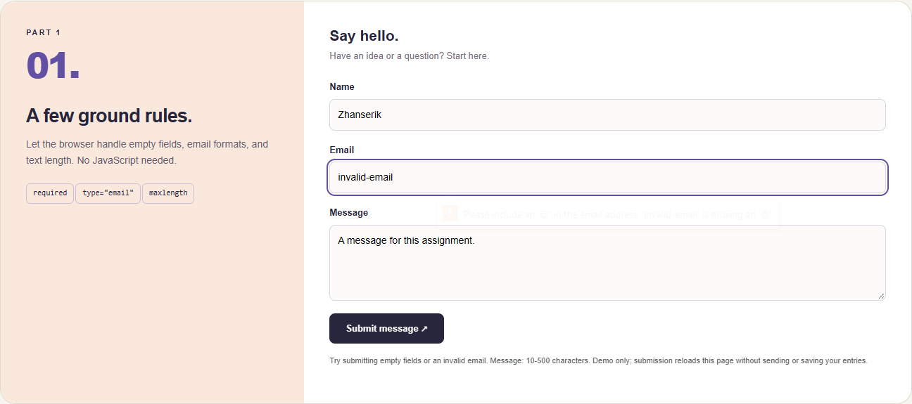

Part 2. Bootstrap Forms

Task 2. Bootstrap Form Styling

The contact form uses form-control, form-label, form-text, and btn classes. Bootstrap row and col-sm-6 place Name and Email side by side on wider screens and stack them on phones. The fields include placeholders and helper text.

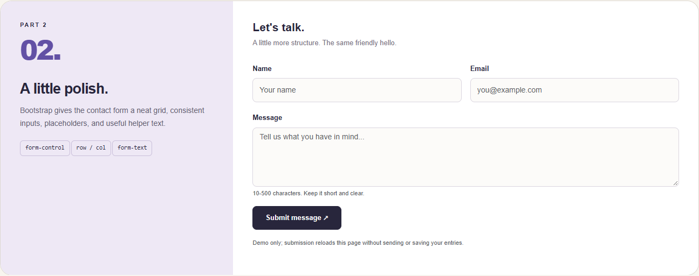

Task 3. Bootstrap Validation Styles

Read-only examples demonstrate is-valid and is-invalid with Bootstrap feedback messages. The editable form uses CSS :user-valid and :user-invalid to show Bootstrap valid-feedback and invalid-feedback after interaction or a submit attempt. This avoids JavaScript. The browser still handles submission validation.

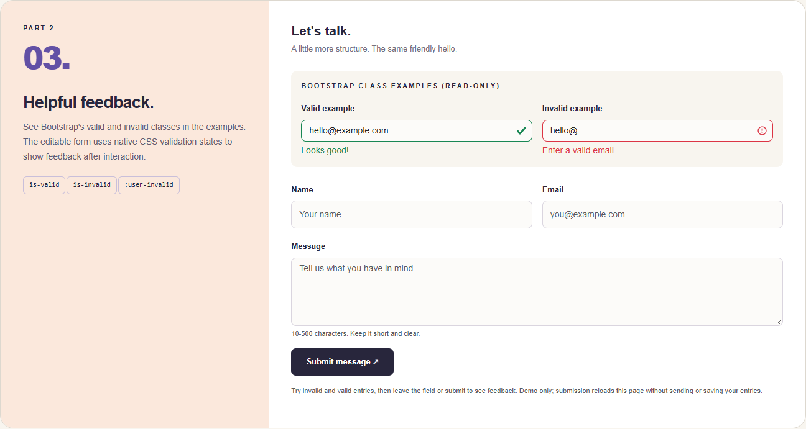

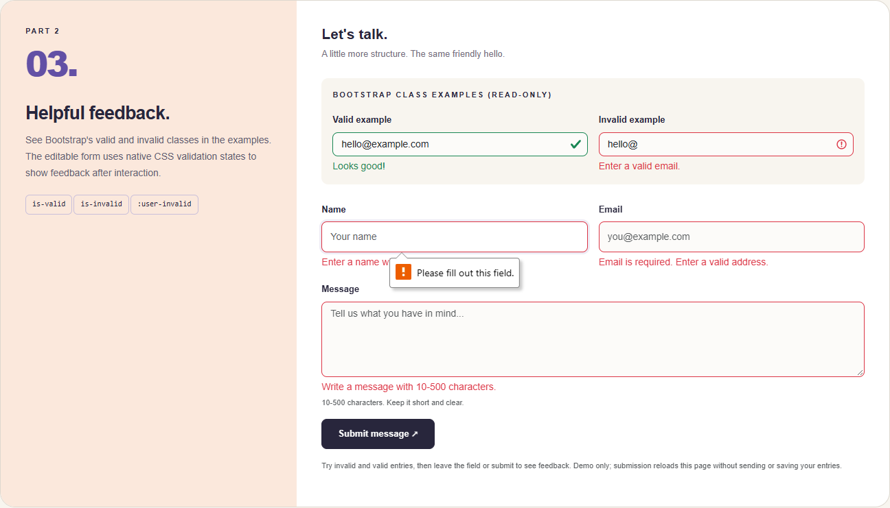

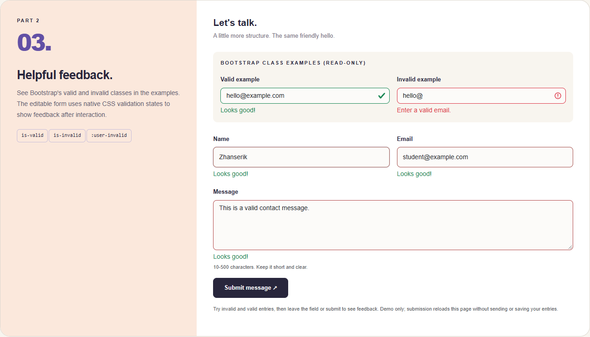

Part 3. Advanced Form Project

Task 4. Registration Form

The registration form includes First Name, Last Name, Email, Password, Confirm Password, Gender radio buttons, Hobbies checkboxes, a Country dropdown, Submit, and Reset. It uses the responsive Bootstrap grid. Password fields require 8 to 64 characters. Required inputs show validation feedback. Gender is required; hobbies are optional.

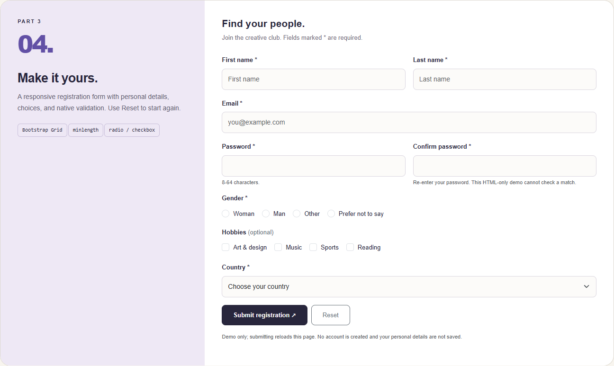

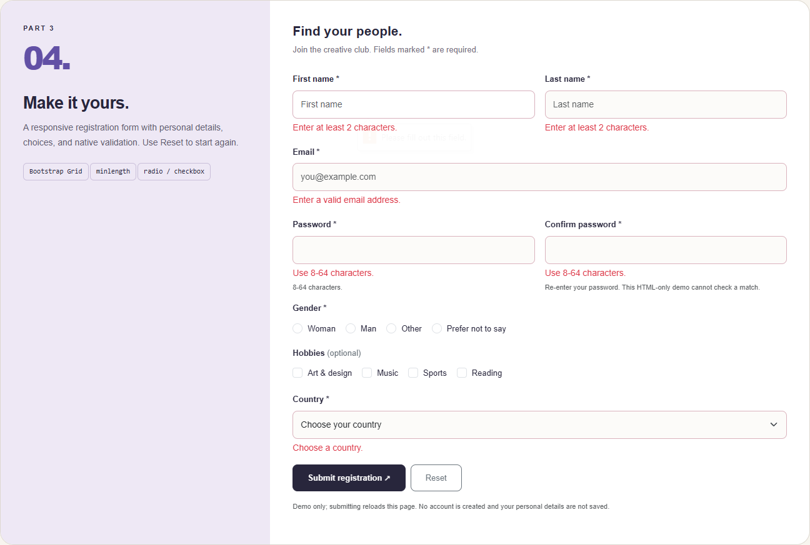

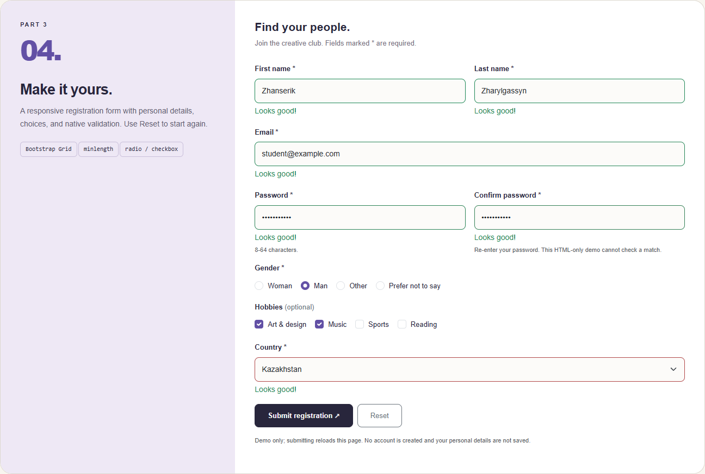

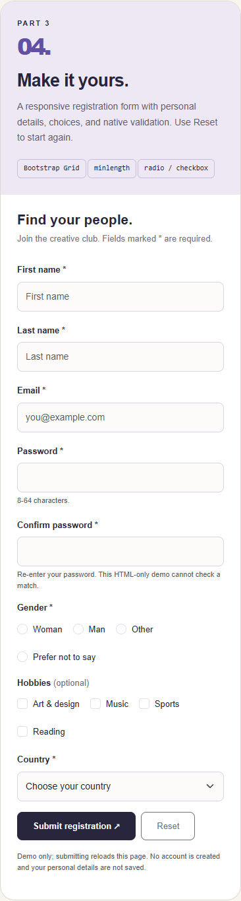

Work process

I started with the basic contact form and added HTML5 validation. Then I added Bootstrap classes and the grid. I demonstrated Bootstrap validation classes and used CSS for feedback in the editable forms. Finally, I created the registration form and added the cream, purple, and orange styling. Browser checks covered required fields, invalid email, password length, valid and invalid feedback, radio buttons, checkboxes, Reset, and the mobile layout. Screenshots are actual browser captures.

Limitations

This is a front-end assignment demo. Submitting a valid form reloads the page; it does not send messages or create accounts. Text fields deliberately omit the name attribute so personal details and passwords are not submitted. The gender radio buttons share a name for grouping, so that choice appears in the registration demo URL. HTML cannot compare Password and Confirm Password; both fields check their own length only. CSS feedback requires a browser supporting :user-valid and :user-invalid; native HTML validation still works without those selectors.

Files

index.html contains all five assignment tasks.
styles.css contains the custom design and CSS validation states.
assets/bootstrap.min.css contains Bootstrap.
assets/bootstrap-LICENSE.txt contains Bootstrap's license.
screenshots contains the task screenshots.

References

https://getbootstrap.com/docs/5.3/forms/overview/
https://getbootstrap.com/docs/5.3/forms/validation/
https://developer.mozilla.org/en-US/docs/Learn_web_development/Extensions/Forms
